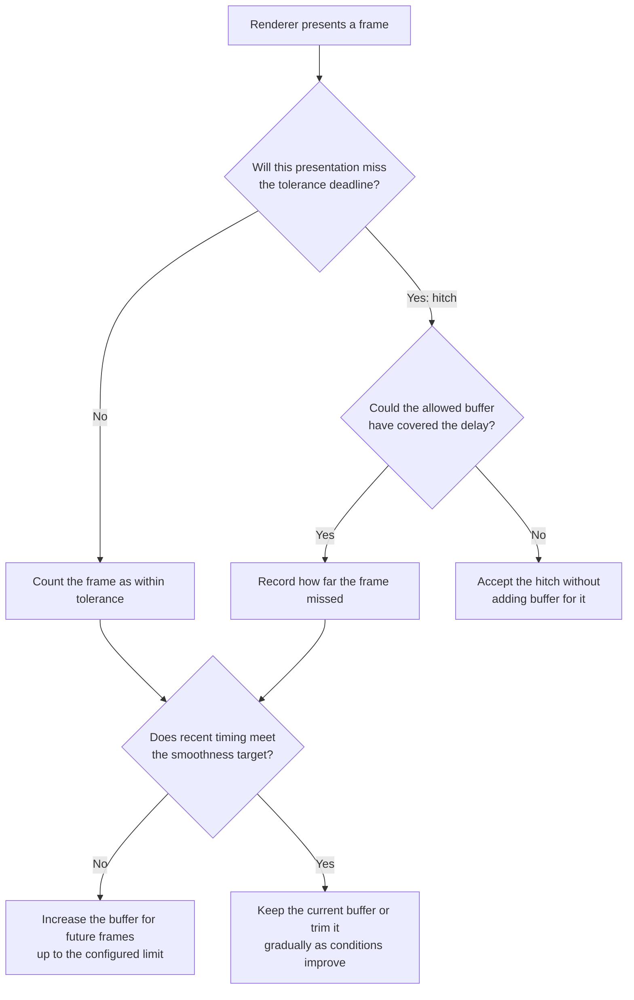
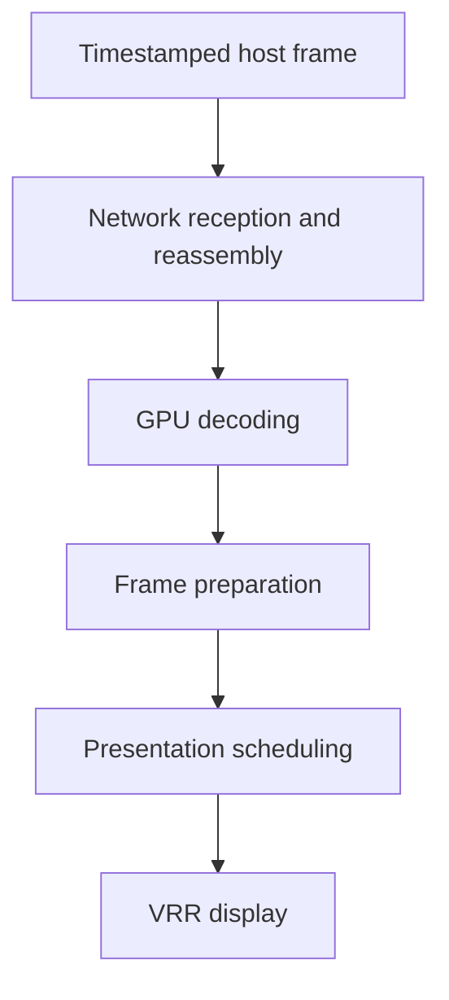

# How VRR improves game streaming

The main benefit of variable refresh rate (VRR) is that a display can adapt its refresh timing to the frames it receives. This helps maintain smooth motion when a game’s frame rate changes and can reduce presentation latency even when the game is running at a steady frame rate.

[Moonlight](https://moonlight-stream.org/) is an open-source game streaming client developed by the community. I forked Moonlight and adapted its frame pacing and presentation pipeline to make better use of VRR. The implementation combines an adaptive timing buffer with software-based adaptive V-Sync to preserve smooth motion while minimizing unnecessary buffering and synchronization delays.

Even if the game produces every frame on time, some frames take a little longer to cross the network or finish decoding. One way to absorb that jitter is to keep an extra frame queued in advance. At 120 FPS, that adds 8.33 milliseconds of delay to every frame. The adaptive buffer in my fork adjusts the wait to the amount of jitter the stream actually has. If 2 milliseconds is enough, the client can show each frame 6.33 milliseconds sooner than with a full frame of additional buffering. That’s **76% less buffering delay** than keeping a full frame in reserve.

## Understanding fixed refresh and judder

Judder is the uneven motion you can see when some frames stay on screen longer than others. The game may take longer to render one frame, or a frame may take longer to cross the network or finish decoding. A fixed-refresh display can also introduce judder when the game is running steadily.

A fixed-refresh display starts drawing a new image at regular intervals. With V-Sync enabled, if the next frame is still being prepared when a refresh starts, the display draws the previous frame again. That image stays on screen for two refresh intervals. During a smooth camera pan, the extra time on one image can look like a brief pause.

## How variable refresh rate helps

VRR also helps when a game settles at a frame rate below the display’s maximum. At a steady 100 frames per second (FPS), the game produces a new image every 10 milliseconds (ms). A fixed 120 Hz screen refreshes 120 times a second, so those frames don’t line up with every refresh. Some images stay on screen twice as long as others. A VRR screen can show each image for the same 10 ms, which makes a slow pan look smoother.

### How VRR changes the relationship between rendering and scanout

A display draws an image progressively from top to bottom. This process is called **scanout**. With fixed refresh, a new scanout begins at predetermined intervals. Traditional blocking V-Sync can make an application wait for one of those intervals before presenting a completed frame, which can also delay the preparation of subsequent frames.

VRR gives the application more flexibility over when the next refresh begins. Once the previous scanout has finished, the display can extend its blanking interval and wait for the next frame rather than immediately beginning another refresh on a fixed schedule.

With an appropriately designed rendering and presentation pipeline, the application can prepare the next frame while the display is still scanning out the previous one. It can then present the completed frame as soon as the display is ready to accept it safely. This can avoid unnecessary blocking and allow more of the rendering work to overlap with scanout.

VRR does not make the GPU render faster or allow the display to exceed its maximum refresh rate. It gives software more control over presentation timing. **Frame pacing is what allows software to take advantage of that flexibility without introducing uneven motion or tearing.**

### Why VRR can reduce latency even near the maximum frame rate

Even if the game produces every frame on time and the network delivers them perfectly evenly, those frames can still be ready between refreshes. With V-Sync enabled, a fixed-refresh screen has to wait for its next refresh. A compatible VRR screen can start refreshing when the frame is ready, provided the previous scanout has finished and the display is still within its VRR timing window. That can make the controls feel more responsive even when motion already looks smooth.

For example, suppose the screen starts repeating the old image at 8.33 ms and the new one is ready at 8.50 ms. The fixed screen can show it at 16.67 ms. A VRR screen that’s still waiting can show it at 8.50 ms. Missing the refresh by a fraction of a millisecond means **VRR can show that frame about 8 ms sooner**. [VESA Adaptive-Sync white paper, Figure 3 (PDF)](https://www.vesa.org/wp-content/uploads/2014/07/VESA-Adaptive-Sync-Whitepaper-140620.pdf#page=3)

## Why streaming needs adaptive frame pacing

Moonlight already supported VRR before I forked it. When frames reached the display at the same steady pace the game produced them, a compatible display could follow that pace. The weakness showed up when one frame took longer to cross the network or finish decoding. One image could stay on screen too long, leaving too little time to show the next one on schedule.

### Local gaming versus game streaming

When playing locally, a completed frame can be handed directly to the local presentation pipeline. Under favorable conditions, the variation introduced by that handoff can be measured in microseconds. This does not mean rendering or scanning out an entire frame takes only microseconds; those operations can still take several milliseconds.

Game streaming introduces additional stages between the game and the display. The host must capture and encode each frame, transmit it over the network, and the client must reassemble and decode it before it can be presented. Variations in these stages can cause frames to become ready several milliseconds earlier or later than expected, even when the game itself produces frames at a perfectly steady rate.

For example, a game running at 120 FPS produces a frame every 8.33 ms. A 2 ms variation in delivery is nearly a quarter of that frame interval. If the client simply presents every frame as soon as it becomes ready, VRR can reproduce that irregular timing on the display. The display has no way of knowing that the game originally produced those frames at equal intervals.

This is why frame pacing is particularly important for streaming. The client needs to reconstruct the game's intended frame timing and reserve enough time to absorb fluctuations in delivery. A small timing buffer gives early frames somewhere to wait and late frames an opportunity to arrive before their scheduled presentation.

### Why the buffer needs to be adaptive

A traditional fixed frame queue can absorb jitter, but it adds the same amount of latency whether the connection needs it or not. My fork instead uses a dynamically adjusted timing buffer that aims to reserve only as much time as the stream needs.

At 120 FPS, queuing one extra frame adds 8.33 ms to every frame you see. Saving just 4 ms cuts that buffering delay by **48%**. Suppose the network and decoder together need only 2 ms of leeway to keep frames ready on time. The adaptive buffer can use those 2 ms and show each frame 6.33 ms sooner than with a full additional frame queued. If frames start taking longer to arrive or decode, the buffer can grow again.

| Buffering approach | Additional latency |
| --- | ---: |
| One additional frame | 8.33 ms |
| Adaptive timing buffer | 2.00 ms |
| **Buffering delay saved in this example** | **6.33 ms (76%)** |

### Keeping the game’s original timing

The adaptive pacing implementation uses host frame timestamps to reconstruct when the gaming PC produced each frame. Suppose the game produces three frames 10 ms apart. The second takes an extra 2 ms to cross the network and the third arrives on time.

| Time between frames | First to second | Second to third |
| --- | ---: | ---: |
| On the gaming PC | 10 ms | 10 ms |
| When they arrive | 12 ms | 8 ms |
| With adaptive frame pacing | 10 ms | 10 ms |

With enough time in the buffer, the client can use those timestamps to show the frames at their original pace. You see the same steady pan you would have seen on the gaming PC.

### What happens when a frame is late

Sometimes a frame takes longer to arrive or decode than the buffer can cover. It misses its scheduled time on screen. That’s a hitch. During a camera pan, you might see the picture hesitate. Dropping the late frame would skip a step in the pan, and showing the next two frames too close together can make the motion look like it suddenly speeds up.

I adapted Moonlight’s frame recovery behavior to show the late frame and, when it makes motion smoother, let it stay on screen a little longer before showing the next one. That’s similar to how V-Sync would space those frames. I prefer that small, temporary delay to a visible skip. If the stream falls far enough behind and a newer frame is ready, the client can still skip ahead to catch up. This recovery also works with **Reduce judder** turned off.

## How my VRR optimizations for Moonlight work

### Software-based adaptive V-Sync

The presentation mechanism in my fork is effectively a form of **software-based adaptive V-Sync**. The concept is similar to [Special K’s Latent Sync](https://wiki.special-k.info/advanced/video), which uses software-controlled presentation timing to reduce the latency associated with conventional V-Sync. My implementation applies a similar timing principle to a different problem: presenting remotely rendered frames on a VRR display despite fluctuations in their delivery.

On the supported Windows DXGI presentation path, the client schedules frames in software and attempts to present them without blocking on conventional V-Sync when the display timing permits. It uses V-Sync as a fallback when it cannot safely present a frame without synchronization.

This allows the decoder and renderer to prepare frames ahead of their intended presentation times, while the pacing logic controls when they are submitted to the display. The adaptive buffer handles delivery jitter, and the presentation logic handles the physical timing constraints of the display. Together, they allow the client to take better advantage of VRR while minimizing unnecessary waiting.

### Streaming near the display’s maximum refresh rate

The effect of a late frame in the original Moonlight was especially noticeable when streaming at **90–100% of the display’s maximum refresh rate**. A 120 Hz TV needs at least 8.33 ms between refresh starts. At 60 FPS, frames are normally 16.67 ms apart, leaving 8.33 ms of leeway. At 119.9 FPS, that leeway shrinks to about **7 microseconds**. VRR can wait for a late frame, but once the TV starts drawing it, the following frame still has to wait its turn. With V-Sync enabled, a frame that misses its intended time this way waits for the next refresh the TV can start.

You could see this in the TV’s on-screen refresh counter. During a scene running at **90–100 FPS**, the readout on some 120 Hz TVs would repeatedly swing from **90–100 Hz up to about 118 Hz** and back. The game could be running steadily the whole time. A delayed frame followed closely by an on-time frame can produce that swing as the TV briefly refreshes near its ceiling. Confirming that a particular frame used V-Sync requires a client timing trace.

The adaptive pacing implementation in my fork uses host frame timestamps and a timing buffer to preserve the original spacing through small network or decoding delays. On the same scene, you can look for fewer jumps to 118 Hz and more even motion during a slow camera pan. Some players who already found the original client smooth described the difference as night and day. **You can still stream at the full 120 FPS** with VRR and the fork’s V-Sync setting enabled on a supported renderer.

Refresh intervals at common display rates

| Display refresh rate | Normal refresh interval | Frame duration after one missed refresh |
| ---: | ---: | ---: |
| 60 Hz | 16.67 ms | 33.33 ms |
| 90 Hz | 11.11 ms | 22.22 ms |
| 120 Hz | 8.33 ms | 16.67 ms |
| 144 Hz | 6.94 ms | 13.89 ms |
| 240 Hz | 4.17 ms | 8.33 ms |

### Why frames arrive at inconsistent intervals

Even when the stream has a fixed target bitrate, the amount of encoded data in each frame can vary. A still scene may take very little data to send. A fast camera turn can produce a larger frame that takes longer to reach the player.

A busy network can delay parts of a frame or deliver them out of order. Packets belonging to a later frame can arrive before all the packets belonging to an earlier frame. The client has to reassemble frames and respect decoding dependencies before presenting them in the appropriate order. This is how a game running at a steady pace can still reach the player unevenly.

### Adaptive buffering

The adaptive pacing implementation uses host frame timestamps to schedule frames on the player’s device. It keeps that schedule aligned even if the clocks on the two devices gradually drift apart. If frames often miss their scheduled time by a little, the buffer can grow. As conditions improve, it can gradually shrink again.

*The tolerance deadline is the frame’s scheduled presentation time plus the allowed lateness. The controller counts a miss as a hitch even when it is too small for the player to notice. The buffer decision affects whether a similar delay will cause a hitch on a later frame.*

A **lower smoothness target** lets the controller accept more timing misses and keep less delay in reserve. Some players prefer that responsiveness and barely notice an occasional late frame. A higher target gives more frames time to arrive on schedule.

For example, with a 2 ms timing buffer, a frame that takes an additional 1 ms to travel across the network can still be presented on schedule, provided decoding and preparation also finish before the deadline.

If a delay exceeds the current buffer, the renderer may still miss this frame’s target. Increasing the buffer helps only when the extra time can protect future frames.

### Network jitter versus decoding jitter

As long as a frame completes decoding and preparation before its scheduled presentation deadline, variations earlier in the pipeline can be absorbed by the available timing buffer.

Decoding jitter can also be absorbed, but GPU processing introduces additional complications. A slow decode may delay subsequent frames or compete with rendering and presentation for GPU resources.

Where supported, the implementation tracks actual GPU decode readiness instead of assuming a frame is ready simply because the decoder has returned it. Frames are also prepared ahead of their presentation deadlines whenever possible, allowing GPU processing to overlap with the intentional pacing delay.

Once the frame is ready, the client still has to show it safely. On the Windows DXGI path, the fork’s presentation logic spaces unsynchronized submissions by at least one refresh interval plus a small safety margin. If the screen is still drawing the previous frame, or the client can’t confirm that the gap between refreshes is still open, it uses **V-Sync for that frame** and lets Windows handle the spacing. A long delay can trigger the same protection because the display may already be repeating the previous frame.

## VRR timing settings in my Moonlight fork

**Low Latency** keeps less time in reserve for late frames. **Smooth** allows a longer wait to keep motion steady when frames arrive unevenly. **Balanced** falls between the two.

| Preset | Maximum buffer allowance | Timing target | History | Tolerance |
| --- | ---: | ---: | ---: | ---: |
| **Low Latency** | 1 source frame | 99% | 60 seconds | 0.5 ms |
| **Balanced** | 2 source frames | 99.5% | 120 seconds | 0.5 ms |
| **Smooth** | 4 source frames | 99.99% | 300 seconds | 0.2 ms |

The **maximum buffer allowance** is how long the buffer is allowed to wait. On a good connection, the actual wait can be much shorter.

The following table shows how much delay one source frame represents at each stream frame rate.

| Stream frame rate | Latency from one additional buffered frame |
| ---: | ---: |
| 30 FPS | 33.33 ms |
| 60 FPS | 16.67 ms |
| 90 FPS | 11.11 ms |
| 120 FPS | 8.33 ms |
| 144 FPS | 6.94 ms |
| 240 FPS | 4.17 ms |

The **tolerance** sets how late a frame can be and still count as on time. Beyond that, larger misses count more heavily against the **timing target**. A higher target encourages the buffer to keep more time in reserve. **History** is how far back the adaptive controller looks when making that adjustment.

Users can also customize these settings to achieve their preferred balance between smoothness and responsiveness.

### Reduce judder

**Reduce judder** adjusts when frames appear so the time between them is more even. During a steady camera pan, for example, the game might produce one frame after 9 ms and the next after 11 ms. Showing the middle frame 1 ms later would make both gaps 10 ms. The pan can look smoother, and only the middle frame needs to wait.

The trade-off is that a frame whose timing needs adjusting may appear a little later. If the game already produces evenly spaced frames, there’s no unevenness for this setting to correct. At the screen’s maximum refresh rate, the way the client schedules frames can also affect latency.

## Limitations

VRR and adaptive frame pacing cannot eliminate every form of stuttering. Significant packet loss, sustained GPU overload, large host-side frame stalls and display limitations can still produce visible disruptions.

Increasing the buffer indefinitely would also make the stream increasingly unresponsive. For this reason, I designed the controller to distinguish recoverable timing fluctuations from problems that additional buffering cannot meaningfully resolve.

The ultimate goal of my Moonlight fork’s VRR optimizations is to make streaming feel as close as possible to playing directly on the host. By combining adaptive buffering with software-controlled presentation timing, the client can preserve smooth motion without introducing more latency than necessary.
