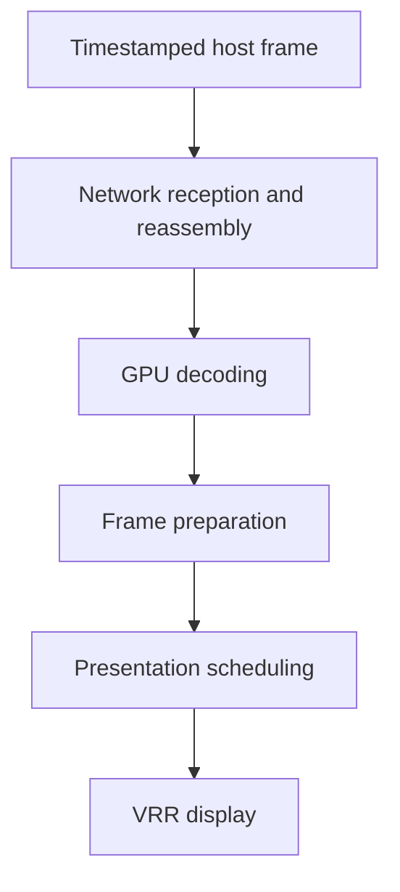
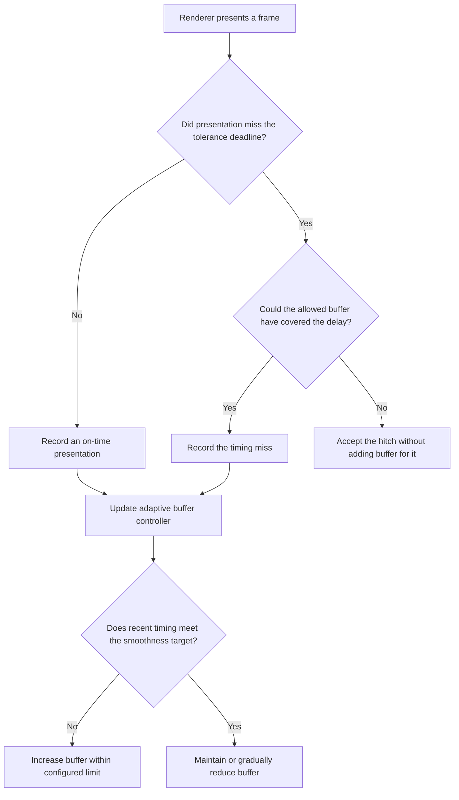

# How VRR improves game streaming

Variable refresh rate (VRR) combined with adaptive frame pacing can **significantly reduce latency and improve motion smoothness at the same time**, even when the game itself already has perfect frame pacing.

At 120 FPS, keeping an additional frame in reserve to absorb streaming jitter adds 8.33 milliseconds (ms) of latency. With VRR and adaptive frame pacing, the client can use a smaller timing buffer instead of waiting for an entire additional frame. If only 2 ms of buffering is needed, it can present frames **6.33 ms sooner, reducing buffering latency by 76%** while maintaining smooth motion.

[Moonlight](https://moonlight-stream.org/) is a community-developed, open-source game streaming client that already supported VRR. I forked Moonlight to optimize its frame pacing and presentation pipeline for VRR through adaptive buffering and software-based adaptive V-Sync.

## Fixed refresh versus VRR

A display draws each image progressively from top to bottom, a process called **scanout**. A fixed-refresh display starts a new scanout at regular intervals. At 120 Hz, this happens every 8.33 ms.

**Judder** is the uneven motion caused by frames remaining on screen for different lengths of time. During a steady camera pan, a frame that remains visible longer than its neighbors can make the motion appear to hesitate.

With V-Sync enabled, if a new frame is not ready before the next fixed refresh, the display repeats the previous image. At 120 Hz, that image remains visible for 16.67 ms instead of 8.33 ms. This can happen because of inconsistent game frame pacing or streaming jitter.

Judder can occur even when the game produces frames at perfectly regular intervals. For example, a game running at 100 FPS produces a new frame every 10 ms, which does not align with the refresh intervals of a fixed 120 Hz display. Some frames remain visible for 8.33 ms and others for 16.67 ms, even though the game itself is perfectly consistent.

VRR allows the display to extend the gap between scanouts until the next frame is ready, within its supported refresh range. At a steady 100 FPS with evenly paced presentation, a compatible VRR display can show each image for 10 ms, eliminating this source of judder.

### Reducing presentation latency

With traditional blocking V-Sync, waiting for a refresh can delay the application's next rendering operation. VRR, combined with an appropriately designed presentation pipeline, lets software prepare frames while the previous image is still being scanned out and submit them when the display is ready. This reduces unnecessary synchronization delays without requiring the GPU itself to render faster.

For example, if a frame becomes ready at 8.50 ms, just after a fixed 120 Hz display begins another refresh at 8.33 ms, it must wait until 16.67 ms to be shown. A VRR display that has extended its blanking interval can begin refreshing at 8.50 ms instead, saving approximately **8 ms of presentation latency** in this example.

See the [VESA Adaptive-Sync white paper, Figure 3 (PDF)](https://www.vesa.org/wp-content/uploads/2014/07/VESA-Adaptive-Sync-Whitepaper-140620.pdf#page=3).

### Streaming near the maximum refresh rate

VRR cannot start a new refresh before the display is ready. As the frame rate approaches the display's maximum refresh rate, there is progressively less room to accommodate inconsistent frame delivery.

| Frame rate on a 120 Hz display | Frame interval | Timing headroom above minimum refresh interval |
| ---: | ---: | ---: |
| 60 FPS | 16.67 ms | 8.33 ms |
| 100 FPS | 10.00 ms | 1.67 ms |
| 119.9 FPS | 8.34 ms | 7 µs |
| 120 FPS | 8.33 ms | 0 ms |

In the original Moonlight client, the effect was especially noticeable when streaming near the display's maximum refresh rate. On some 120 Hz TVs, even a steady 90–100 FPS scene could cause the refresh counter to repeatedly jump to around 118 Hz as delayed frames were followed closely by subsequent frames.

A refresh counter can reveal irregular presentation intervals, although determining whether V-Sync was used for an individual frame requires a client timing trace.

## Why game streaming needs frame pacing

When playing locally, the handoff of a completed frame into the presentation pipeline can have microsecond-scale timing variation under favorable conditions. With game streaming, the host must capture and encode frames, and the client must receive, decode and prepare them. Variation across these stages can introduce several milliseconds of jitter.

Even with a fixed target bitrate, individual encoded frames vary in size depending on how much the scene changes. A fast camera turn may produce a larger frame than a stationary image. Network congestion can also delay packets or cause packets belonging to a later frame to arrive before an earlier frame has been fully received.

VRR follows the timing of the frames presented to it. Without frame pacing, irregular delivery can become visible as irregular motion, even when the game itself is running smoothly.

### Reconstructing the game's frame timing

The pacing implementation uses host frame timestamps to reconstruct the original frame intervals. In this example, a game produces frames 10 ms apart, but the second frame experiences an additional 2 ms of network delay.

| Time between frames | Frame 1 to 2 | Frame 2 to 3 |
| --- | ---: | ---: |
| Original game timing | 10 ms | 10 ms |
| Arrival timing | 12 ms | 8 ms |
| Paced presentation | 10 ms | 10 ms |

A small timing buffer lets early frames wait until their scheduled presentation time and gives late frames an opportunity to arrive in time. With sufficient buffering, the client can reproduce the game's original motion.

### Why adaptive buffering reduces latency

A fixed frame queue absorbs jitter by keeping an additional frame in reserve. However, the delay remains even when the stream does not need that much buffering.

My adaptive buffer adjusts the delay according to observed timing variation. At 120 FPS, if only 2 ms of buffering is needed, the difference is substantial:

| Buffering approach | Additional latency |
| --- | ---: |
| One additional frame | 8.33 ms |
| Adaptive timing buffer | 2.00 ms |
| **Buffering delay saved** | **6.33 ms (76%)** |

This percentage refers to buffering delay, rather than total end-to-end streaming latency.

## How the VRR optimizations work

### Frame processing pipeline

Both network and decoding jitter can be absorbed as long as frame processing finishes before the scheduled presentation deadline. GPU delays can be more complicated because slow decoding may also delay subsequent frames or compete with rendering for GPU resources.

Where supported, the implementation tracks actual GPU decode readiness rather than assuming a frame is ready as soon as the decoder returns it. Preparing frames in advance allows GPU processing to overlap with the pacing delay.

### Adaptive buffer controller

The controller maintains a presentation schedule based on host timestamps while accounting for clock drift between the host and client. It evaluates recent presentation timing against a configurable smoothness target to determine how much buffering is necessary.

The tolerance deadline is the scheduled presentation time plus the configured lateness tolerance. A miss counts against timing performance even if it is too small for the player to notice. Buffer adjustments affect future frames; they cannot recover time already lost to a late frame.

### Software-based adaptive V-Sync

The presentation mechanism is conceptually similar to [Special K's Latent Sync](https://wiki.special-k.info/advanced/video). It uses software-controlled timing to minimize reliance on conventional V-Sync while respecting the display's refresh constraints.

The client schedules presentations in software and submits frames without waiting for conventional V-Sync whenever the display timing permits. When it cannot safely present a frame this way, it can fall back to **OS-scheduled V-Sync for that frame**. This fallback is used across platforms and lets the operating system handle synchronization when needed.

This approach allows streaming at the full 120 FPS on a compatible 120 Hz display with VRR and the client's V-Sync setting enabled, while avoiding unnecessary synchronization waits whenever possible.

### Recovering from late frames

When a frame arrives too late for the current buffer to absorb, a visible hitch may occur. Immediately dropping the frame or presenting the following frame too quickly can make motion appear to skip or suddenly accelerate.

In most cases, preserving a late frame and using OS-scheduled V-Sync when necessary produces smoother motion than immediately dropping it. The recovery logic can also adjust subsequent presentation timing to avoid showing frames too close together. If the stream falls far enough behind and a newer frame is available, the client can still skip ahead to catch up. This behavior also works with **Reduce judder** disabled.

## VRR timing settings

The presets control the trade-off between responsiveness and timing consistency.

| Preset | Maximum buffer allowance | Timing target | History | Tolerance |
| --- | ---: | ---: | ---: | ---: |
| **Low Latency** | 1 source frame | 99% | 60 seconds | 0.5 ms |
| **Balanced** | 2 source frames | 99.5% | 120 seconds | 0.5 ms |
| **Smooth** | 4 source frames | 99.99% | 300 seconds | 0.2 ms |

- **Maximum buffer allowance:** The upper limit on intentional buffering, rather than a fixed amount of delay.
- **Timing target:** The desired timing performance. A lower target accepts more timing variation in exchange for potentially lower latency.
- **History:** How far back the controller looks when adjusting the buffer.
- **Tolerance:** How late a frame may be before it counts as a timing miss. Larger misses beyond the tolerance weigh more heavily against the timing target.

These settings can also be customized.

Buffering delay by stream frame rate

| Stream frame rate | Delay from one additional buffered frame |
| ---: | ---: |
| 30 FPS | 33.33 ms |
| 60 FPS | 16.67 ms |
| 90 FPS | 11.11 ms |
| 120 FPS | 8.33 ms |
| 144 FPS | 6.94 ms |
| 240 FPS | 4.17 ms |

### Reduce judder

This optional setting smooths irregularities in the game's original frame pacing, beyond the correction of delivery jitter.

For example, if the game produces consecutive frame intervals of 9 ms and 11 ms, delaying the middle frame by 1 ms produces two even 10 ms intervals. This can improve motion smoothness at the cost of slightly delaying frames whose timing needs correction. If the game's original frame pacing is already consistent, there is no unevenness for this setting to correct.

## Limitations

Adaptive frame pacing cannot eliminate every form of stuttering. Significant packet loss, sustained GPU overload, large host-side stalls and the physical limitations of the display can still cause visible disruptions. The controller avoids increasing the buffer to compensate for delays that cannot reasonably be absorbed within its configured limits.
